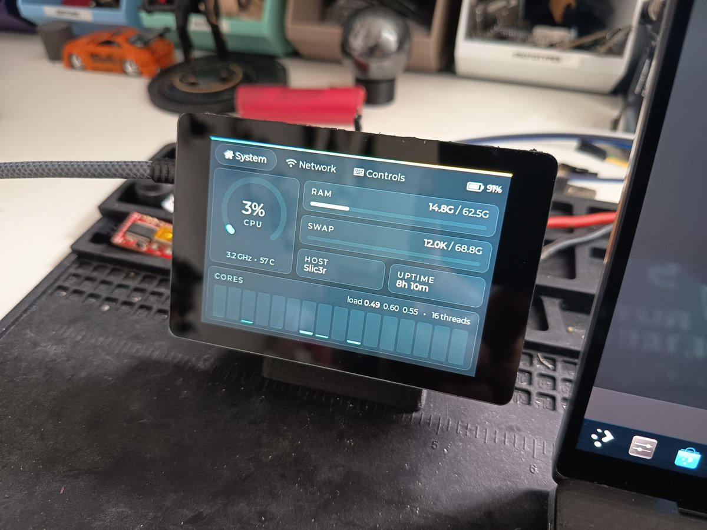
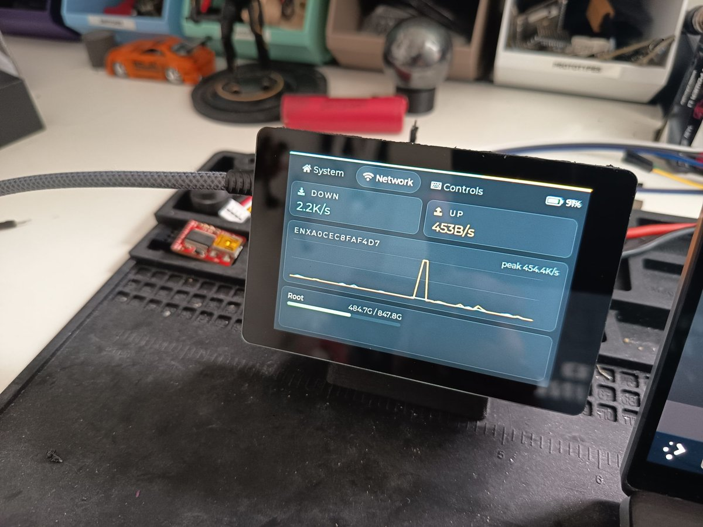
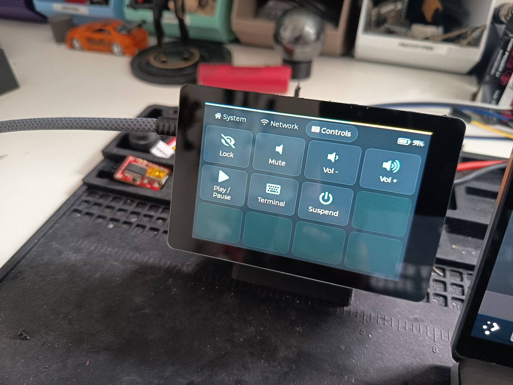
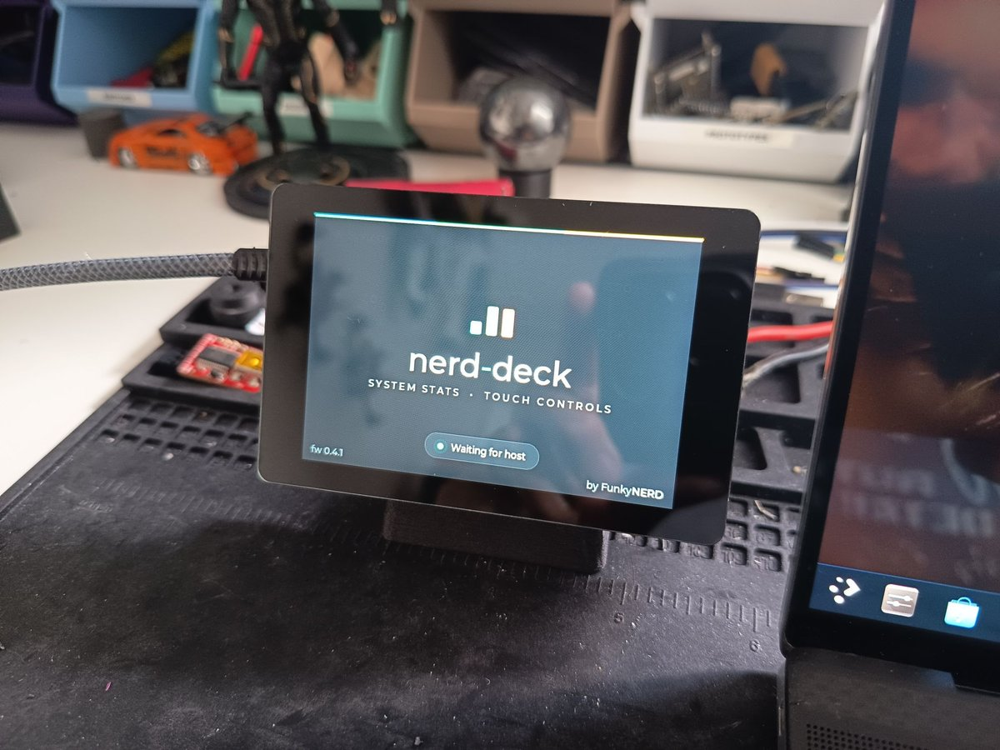

# nerd-deck

A USB desk display for a Linux PC: live CPU, memory, network and disk stats on a
WT32-SC01 Plus, plus a page of touch buttons that run commands on the PC.

| | |
|---|---|
|  |  |
| **System:** CPU, memory, uptime and per-core load, with the laptop's battery in the corner. | **Network:** live traffic and disks, including drives as you plug them in. |
|  |  |
| **Controls:** buttons that run commands on the PC. | **Waiting:** shown until the host app connects. |

```
┌──────────────── PC (Linux) ────────────────┐        USB-C        ┌──── WT32-SC01 Plus (ESP32-S3) ────┐
│ host/  (Rust)                              │  newline-delimited  │ firmware/  (PlatformIO / Arduino) │
│  collector ─ sysinfo → stats ──────────────┼──── JSON ─────────▶ │  protocol → ui (LVGL tabs)        │
│  actions   ◀─ press{id} → sh -c <command>  │ ◀────────────────── │  Controls tab buttons             │
└────────────────────────────────────────────┘                     └───────────────────────────────────┘
```

The message format is in [docs/PROTOCOL.md](docs/PROTOCOL.md).

```bash
git clone git@github.com:FunkyNERD/nerd-deck.git
```

## Hardware

WT32-SC01 Plus: ESP32-S3-WROVER-N16R2 (16 MB flash, 2 MB PSRAM), 3.5" 480×320
ST7796 over an 8-bit parallel bus, and an FT6336U capacitive touch controller. The
USB-C port goes to the S3's native USB, so the board enumerates as `303a:1001`
with no USB-UART bridge. Pin mapping: `firmware/src/board/wt32_sc01_plus.hpp`.

## Firmware

Stack: LovyanGFX for the display and touch, LVGL 8.3 for the UI, and ArduinoJson
for the protocol.

```bash
cd firmware && pio run -t upload
```

Stop the host service first (`systemctl --user stop nerd-deck`), because it
holds the serial port. If upload doesn't start, hold **BOOT** while pressing
**RST** to enter the bootloader.

You don't normally need to flash by hand: the host app bundles the firmware and
installs it on the device (see [Firmware updates](#firmware-updates)). Each build
also writes `.pio/build/wt32-sc01-plus/firmware-merged.bin` (bootloader,
partitions and app in one image, via `merge_firmware.py`), which is what the
host bundles.

Debug build flags:

```bash
PLATFORMIO_BUILD_FLAGS="-DNERD_PERF -DNERD_START_TAB=1" pio run -t upload
```

- `NERD_PERF` prints a `perf fps=... busy=...` line every second. The host logs
  it at `RUST_LOG=debug`.
- `NERD_START_TAB=n` opens on tab `n` (0 System, 1 Network, 2 Controls).

`Serial` carries the protocol. The host skips lines that aren't JSON, so a short
plain-text line like the perf output is harmless. For anything chattier, use a
UART on the extension header.

| File | Purpose |
|---|---|
| `src/main.cpp` | setup/loop |
| `src/display.cpp` | panel + touch → LVGL drivers |
| `src/protocol.cpp` | line framing, JSON decode, `hello`/`press` |
| `src/ui/ui.cpp` | System / Network / Controls tabs, waiting-for-host screen, toasts |
| `src/config.hpp` | version, limits, timeouts |

## Host app

Build requirements: the Rust toolchain plus `libudev-dev`, which `serialport`
needs for USB discovery.

```bash
cd host
cargo build --release
cargo run -- --list-ports   # check the device is visible
cargo run -- --dump         # print one stats sample
cargo run                   # connect and stream (RUST_LOG=debug for more)
```

On first start the app writes `~/.config/nerd-deck/config.toml` from
`config.example.toml` (built into the binary). It never overwrites an existing
config. After editing it, choose **Reload config** in the tray (or restart the
service).

The app finds the device by VID/PID, sends `hello` and the button layout, then
streams stats. It reconnects automatically if the device is unplugged or reset.
Buttons are defined only in the host config. The device sends just a button `id`,
so it can't trigger anything that isn't in that file.

Each button can show a built-in symbol (`icon = "mute"`) or a picture
(`image = "~/icons/obs.png"`, PNG, JPEG or BMP) above its label. The host scales
images to fit 40×40 and sends them to the device each time it sends the button
layout. See `host/config.example.toml` for the icon names.

### Desktop notifications

The device can show your desktop notifications too, such as new mail: it dims
the screen and slides a card down for 8 seconds (tap to dismiss). Critical ones
take over the whole screen until you tap Dismiss. It's off by default, since
anyone near your desk can read the display. Turn it on in the config:

```toml
[notifications]
enabled = true
apps = ["Geary"]   # only these apps; leave empty for all
ignore = []        # never these apps
body = true        # false shows just the app and title
```

The host watches the session bus as a monitor, so it works with any desktop:
it reads the freedesktop `Notify` calls that KDE, XFCE and most apps use, and
GNOME Shell's `org.gtk.Notifications`. It leaves out low-urgency notifications,
and holds back the rest while Do Not Disturb is on (Plasma's or GNOME's).
App names work as the desktop
shows them or as their desktop file (`org.gnome.Geary`); the log names each
app as its notifications arrive (`journalctl --user -u nerd-deck | grep notification`).

### Tray icon

`nerd-deck --tray` puts the deck's logo in the system tray: in colour while the
deck is connected, grey while the service waits for it, faded when the service
isn't running. Its menu shows the connection and firmware version, sends test
notifications (normal or critical) to the deck, opens the config for editing
and reloads it, so changes apply without restarting the service. It starts at
login (`install.sh` and the packages set that up). GNOME needs the AppIndicator
extension for a tray; Ubuntu ships it.

The tray is a separate process that talks to the service over D-Bus, so the
deck keeps working without it. The service owns `io.github.FunkyNERD.NerdDeck`
on the session bus:

```bash
busctl --user introspect io.github.FunkyNERD.NerdDeck /io/github/FunkyNERD/NerdDeck
busctl --user call io.github.FunkyNERD.NerdDeck /io/github/FunkyNERD/NerdDeck \
    io.github.FunkyNERD.NerdDeck1 TestNotification b false
```

`Status` returns a dict (connected, port, firmware, version, update, config),
`Reload` re-reads the config (a broken one is rejected and the old one kept),
and `StatusChanged` fires when the status changes.

### Installing

```bash
host/install.sh
```

This builds the device firmware (if PlatformIO is installed) and a release binary
that bundles it, installs the binary to `~/.local/bin/nerd-deck`,
installs the udev rule from `host/packaging/` (asks for sudo), enables a systemd user service that runs with your graphical session,
and starts the tray icon at login.
Re-running it upgrades in place.

| Option | Effect |
|---|---|
| `--no-udev` | skip the udev rule; no sudo needed |
| `--no-service` | don't install or enable the service |
| `--no-tray` | don't start the tray icon at login |
| `--no-firmware` | don't bundle the device firmware; no PlatformIO needed |
| `--uninstall` | remove the binary, service and udev rule (the config is kept) |

Stop the service before flashing firmware, because it holds the serial port:

```bash
systemctl --user stop nerd-deck
```

Logs: `journalctl --user -u nerd-deck -f`

### Firmware updates

A host built with the firmware bundled (`install.sh` with PlatformIO, and every
release package) keeps the device up to date. When the device says hello with
older firmware, the host shows "Updating firmware to …" on the display, resets the
device into the ESP32-S3's ROM bootloader over the same USB cable, writes the
new firmware and resets it. It takes about 15 seconds; the stats come back on their
own.

- **Upgrade only.** A device with the same or newer firmware (say, a dev build
  you flashed with PlatformIO) is left alone.
- **Same board only.** The device reports its board in `hello` (protocol v3),
  and the host only installs firmware built for that board.
- **Recoverable.** The ROM bootloader can't be overwritten. If a flash is
  interrupted, the host reflashes the device the next time it connects and gets
  no hello. It only does that for a device it has seen identify as a nerd-deck
  before, by USB serial number (kept in `~/.local/state/nerd-deck/devices`).
- At most two attempts per device each time the host starts, so it can't loop.

Turn it off with `firmware = false` under `[updates]` in the config. To install
the bundled firmware right away (service stopped):

```bash
nerd-deck --flash-firmware
```

To bundle firmware into a build by hand, point `NERD_DECK_FIRMWARE` at a merged
image; its version and board are read from the image itself:

```bash
NERD_DECK_FIRMWARE=firmware/.pio/build/wt32-sc01-plus/firmware-merged.bin cargo build --release
```

### Packages

Each release has a `.deb` and an `.rpm` (x86_64, glibc 2.35 or newer: Debian 12+,
Ubuntu 22.04+, Fedora 36+), with the device firmware bundled. They install the binary to `/usr/bin`, the udev rule,
the systemd user unit, the tray autostart entry and the example config in
`/usr/share/doc/nerd-deck/`. The
service isn't enabled for anyone, so each user turns it on, and their config is
created on first start:

```bash
systemctl --user enable --now nerd-deck
```

CI builds both packages on every push (`.github/workflows/host-packages.yml`) and
keeps them as a run artifact. To cut a release, set the version in
`host/Cargo.toml`, commit, then push a matching tag:

```bash
git tag v0.2.0 && git push origin main v0.2.0
```

CI publishes the release with both packages attached. Its notes list every commit
since the previous tag, grouped by type (`host/packaging/release-notes.sh`).
To build the packages locally:

```bash
cargo install --locked cargo-deb cargo-generate-rpm
host/packaging/build-packages.sh   # writes host/dist/
```

## Next steps

- Add a settings window to the tray app (Slint): buttons, notification
  filters, stats and updates, written back to the config with its comments.
- Add device settings (brightness, starting tab, screen-off timer), kept on the
  device across reboots.
- Add GPU stats (NVML for NVIDIA, `/sys/class/drm` for AMD).
- Add a host-driven `brightness` message, and a screen-off timer once the host
  has been gone for a while.
- Add multiple button pages.
- Report IP addresses on the Network tab.
- Publish the packages to an APT/RPM repository (Forgejo has package
  registries), so host updates arrive with system updates instead of a notice.
- Restart the user service after a package upgrade, so the new host, and the
  firmware it bundles, take effect without `systemctl --user restart nerd-deck`.
- Build aarch64 packages as well, for ARM hosts such as a Raspberry Pi.
- Support more boards: build the firmware for each one and bundle them all. The
  device already reports its `board`, so the host can pick the matching image.

## License

MIT. See [LICENSE](LICENSE).
